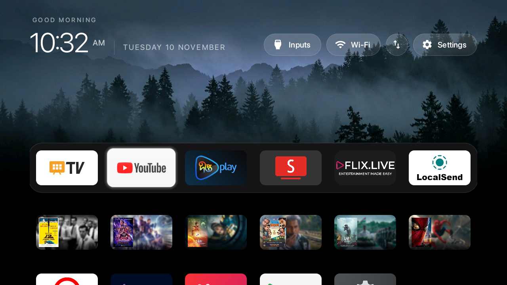
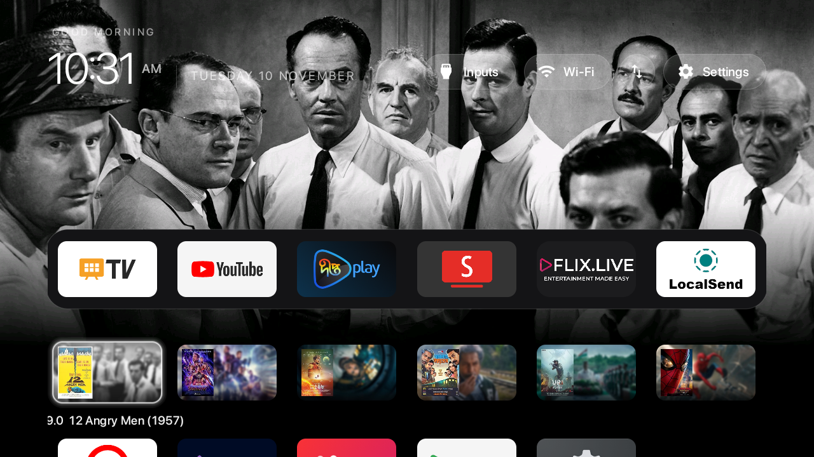
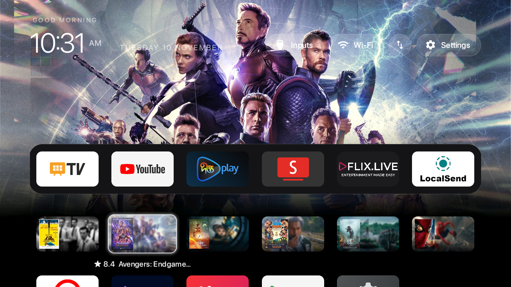

# zen-tv

<p align="center">
  
</p>

<p align="center">
  <b>A minimalist, distraction-free Apple tvOS-inspired launcher for Android TV with a dedicated local Jellyfin Movies Shelf and Moody Nordic landscape aesthetic.</b>
</p>

<p align="center">
  
  
  
  
  
</p>

---

> [!NOTE]
> **Upstream Credits & Attribution:**  
> `zen-tv` is a customized and feature-enhanced edition of the open-source **[CleanYourTV](https://github.com/Gathin23/cleanyourtv)** project by **[@Gathin23](https://github.com/Gathin23)**.  
> All core ADB Wi-Fi debloating scripts, baseline leanback launcher architecture, and input-handling foundation belong to the original author and contributors.

---

## Visual Showcase

### 1. 3-Row Clean Structure with Dedicated Jellyfin Movies Shelf
The home screen is organized into an intentional 3-row hierarchy: Row 1 holds the primary Apps Dock, Row 2 provides a dedicated Jellyfin Movies Shelf, and Row 3 contains secondary apps.

| Default Home (Apps Dock focused) | Dedicated Jellyfin Movie Shelf |
|:---:|:---:|
|  |  |

### 2. Dynamic Backdrop Transitions on Movie Card Hover
Navigating onto any movie card in Row 2 instantly transforms the launcher background into that movie's backdrop, pre-graded to OLED black at the bottom to maintain tile clarity. Moving focus to Row 1 or Row 3 restores the default Moody Nordic Forest Fog wallpaper.

| 12 Angry Men (★ 9.0) Backdrop | Avengers: Endgame (★ 8.4) Backdrop |
|:---:|:---:|
|  |  |

---

## Features & Customizations

### 🎬 Dedicated Jellyfin Movies Shelf (Row 2)
* **Dedicated Row:** A full dedicated shelf of high-rated movies extracted directly from the local Jellyfin server.
* **Instant Hover Backdrop:** Focusing on any movie card transforms the entire TV background into its high-res cinematic backdrop.
* **OLED Black Contrast:** Backdrops are pre-graded with an OLED-friendly gradient from y=500 down, keeping all tiles and text perfectly legible.
* **Seamless Restoration:** Navigating away to the Apps Dock (Row 1) or secondary apps (Row 3) immediately restores the default wallpaper.
* **Direct Playback Launch:** Pressing **`OK`** on any movie card launches directly into Jellyfin.

### 🌲 Moody Nordic Forest Fog Aesthetic
* Minimalist cinematic Scandinavian pine forest silhouettes with rolling atmospheric fog and subtle twilight backlighting.
* Solid obsidian fade across the bottom portion keeps dock tiles sharp and readable.

### 🔤 Apple SF Pro Display Typography
* Authentic SF Pro Display typography integrated into the APK and mapped across:
  * Top bar clock (`10:32 AM`), greeting, and date
  * Status pills (Inputs, Wi-Fi, Settings)
  * Movie ratings and titles under each card
  * Quick Settings dropdown menu

### 📌 Clean 3-Row Layout & Dock Order
* **Row 1 (Apps Dock):** `Live TV`, `YouTube`, `Deepto Play`, `SmartTube`, `FLIX.LIVE` (DFlix), `LocalSend`
* **Row 2 (Jellyfin Movies):** `12 Angry Men`, `Avengers: Endgame`, `Project Hail Mary`, `Bonolota Express`, `Uri: The Surgical Strike`, `Spider-Man: Brand New Day`
* **Row 3 (Other Apps):** `Browser`, `Jellyfin` (native app), `Media`, `Google Play Store`, `Settings` (LeanKey Keyboard hidden)

### 📺 Singer Smart TV 32" (`SLE32E3AGOTV`) Profile
* Tested and optimized for Android TV 14 on the Skyworth `sunnyvale` board with 1GB RAM.
* Complete debloat package list in [`examples/singer-sle32e3agotv/debloat.txt`](examples/singer-sle32e3agotv/debloat.txt).

---

## Automated Jellyfin Asset Pipeline

To update or regenerate the showcased movies from your Jellyfin server:

```powershell
# 1. Query Jellyfin server, fetch top movies, render 16:9 tiles and 1080p OLED backdrops
python tools\jellyfin\generate_assets.py

# 2. Push updated showcase assets to TV over ADB Wi-Fi
python tools\jellyfin\push_assets.py
```

Assets are also embedded directly into [`launcher/app/src/main/assets/jellyfin_showcase/`](launcher/app/src/main/assets/jellyfin_showcase) for instant zero-latency loading.

---

## Building & Installing

### Build Release APK
```powershell
cd launcher
.\gradlew.bat assembleRelease
```
The output APK will be generated at `launcher/app/build/outputs/apk/release/app-release.apk`.

### Deploy to TV over Wi-Fi
```powershell
# Using the CleanYourTV python tool
python tools\tv.py "pm install -r -d /data/local/tmp/tvhome.apk"
```

---

## 1-Click Factory Restoration

To instantly revert all debloated packages and restore your TV to stock:
```powershell
tools\restore.ps1 -TvHost <TV_IP> examples\singer-sle32e3agotv\debloat.txt
```

---

## Acknowledgements

Special thanks to **[@Gathin23](https://github.com/Gathin23)** for creating **[CleanYourTV](https://github.com/Gathin23/cleanyourtv)**.
