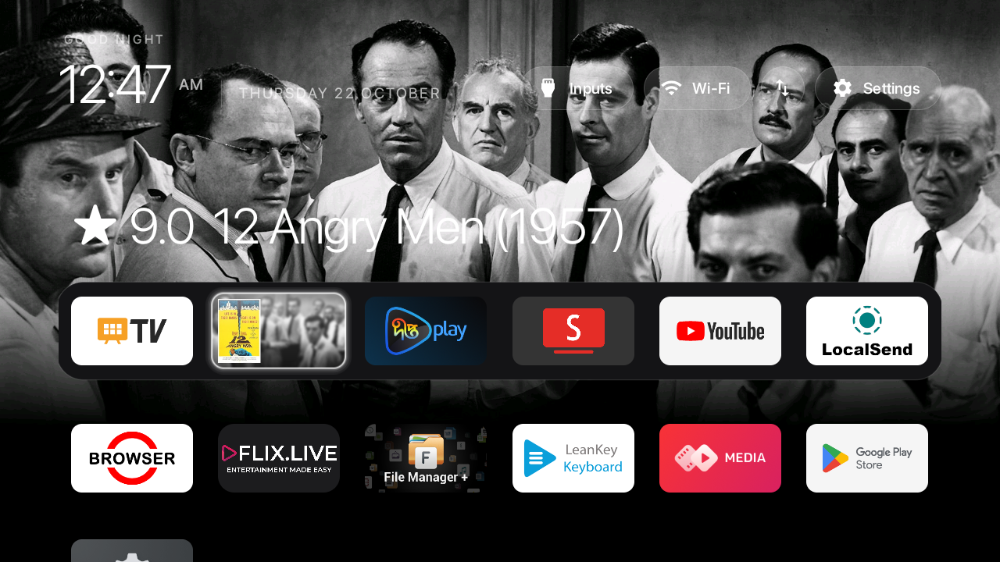
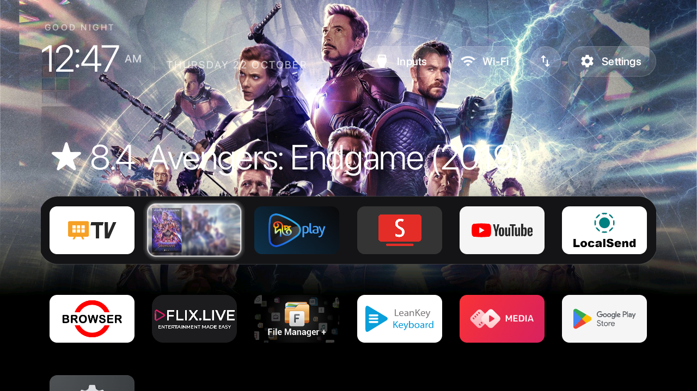
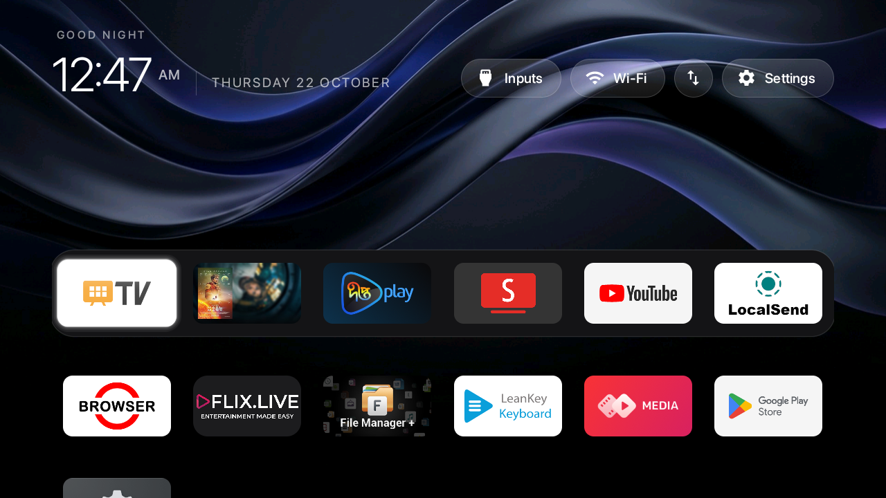
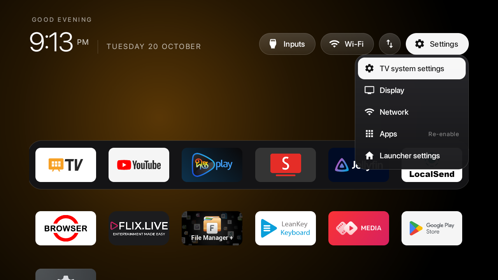

# zen-tv

<p align="center">
  
</p>

<p align="center">
  <b>A minimalist, distraction-free Apple tvOS-inspired launcher for Android TV with a dynamic local Jellyfin Movie Showcase.</b>
</p>

<p align="center">
  
  
  
  
  
</p>

---

> [!NOTE]
> **Upstream Credits & Attribution:**  
> `zen-tv` is a customized and feature-enhanced edition of the open-source **[CleanYourTV](https://github.com/Gathin23/cleanyourtv)** project by **[@Gathin23](https://github.com/Gathin23)**.  
> All core ADB Wi-Fi debloating scripts, baseline leanback launcher architecture, and input-handling foundation belong to the original author and contributors.

---

## Visual Showcase

### 1. Dynamic Jellyfin Movie Showcase (Dock Slot 2)
When hovering over the Jellyfin tile at Slot 2, the launcher transitions the full-screen background into that movie's cinematic backdrop and reveals the rating & title in Apple SF Pro font on the top shelf.

| Hovering on 12 Angry Men (★ 9.0) | Cycled to Avengers: Endgame (★ 8.4) |
|:---:|:---:|
|  |  |

### 2. Apple tvOS Minimal Organic Waves & Quick Settings
Moving focus away to Live TV or any other app immediately restores the default Apple tvOS Organic Waves wallpaper. The top-right settings pill opens an instant frosted glass overlay.

| Default Apple tvOS Wallpaper (Live TV) | Frosted Glass Quick Settings |
|:---:|:---:|
|  |  |

---

## Features & Customizations

### 🎬 Dynamic Jellyfin Movie Showcase (Slot 2)
* **Local Library Extraction:** Automatically extracts and showcases top-rated movies directly from your local Jellyfin Media Server.
* **Instant Hover Backdrop:** Focusing on Slot 2 transitions the launcher wallpaper into that movie's backdrop, pre-graded with an OLED-friendly 45% black gradient at the bottom so dock tiles remain 100% legible.
* **Apple SF Pro Top Shelf Typography:** Displays community rating and movie metadata above the dock (e.g. `★ 9.0  12 Angry Men (1957)`).
* **Interactive D-Pad Cycling & Auto-Rotation:**
  * Press **`D-pad Up`** while focused on Slot 2 to manually cycle through your catalog.
  * Auto-rotates every 7 seconds while hovering.
* **Seamless Wallpaper Restoration:** Moving focus away to Live TV or any other app restores the Apple tvOS Organic Waves wallpaper.
* **Direct App Launch:** Pressing **`OK`** on the tile boots directly into Jellyfin.

### 🌊 Apple tvOS Minimal Organic Waves Aesthetic
* Custom-rendered 1080p silky ribbon curves in slate, dark sapphire, and subtle violet tones.
* Deep obsidian bottom half preserves contrast and eliminates clutter.

### 🔤 Apple SF Pro Display Typography
* Authentic SF Pro Display typography integrated into the APK and mapped across:
  * Top bar clock (`12:47 AM`), greeting, and date
  * Status pills (Inputs, Wi-Fi, Settings)
  * Showcase ratings and titles
  * Quick Settings dropdown menu

### 🪟 Frosted Glass Quick Settings
* Instant dropdown overlay for TV Settings, Wi-Fi, Inputs, and Apps without leaving the home screen.

### 📌 Clean Dock Layout
Configured with an intentional 6-slot dock order:
1. `Live TV` (`com.mediatek.wwtv.tvcenter`)
2. `Jellyfin Movie Showcase` (`org.jellyfin.androidtv`)
3. `Deepto Play` (`com.gotipath.deeptotvapp`)
4. `SmartTube` (`org.smarttube.stable`)
5. `YouTube` (`com.google.android.youtube.tv`)
6. `LocalSend` (`org.localsend.localsend_app`)

### 📺 Singer Smart TV 32" (`SLE32E3AGOTV`) Profile
* Tested and optimized for Android TV 14 on the Skyworth `sunnyvale` board with 1GB RAM.
* Complete debloat package list in [`examples/singer-sle32e3agotv/debloat.txt`](examples/singer-sle32e3agotv/debloat.txt).

---

## Automated Jellyfin Asset Pipeline

To update or regenerate the showcased movies from your Jellyfin server:

```powershell
# 1. Query Jellyfin server, fetch top movies, render 16:9 tiles and 1080p OLED backdrops
python tools\jellyfin\generate_assets.py

# 2. Push updated showcase assets to TV over ADB Wi-Fi
python tools\jellyfin\push_assets.py
```

Assets are also embedded directly into [`launcher/app/src/main/assets/jellyfin_showcase/`](launcher/app/src/main/assets/jellyfin_showcase) for instant zero-latency loading.

---

## Building & Installing

### Build Release APK
```powershell
cd launcher
.\gradlew.bat assembleRelease
```
The output APK will be generated at `launcher/app/build/outputs/apk/release/app-release.apk`.

### Deploy to TV over Wi-Fi
```powershell
# Using the CleanYourTV python tool
python tools\tv.py "pm install -r -d /data/local/tmp/tvhome.apk"
```

---

## 1-Click Factory Restoration

To instantly revert all debloated packages and restore your TV to stock:
```powershell
tools\restore.ps1 -TvHost <TV_IP> examples\singer-sle32e3agotv\debloat.txt
```

---

## Acknowledgements

Special thanks to **[@Gathin23](https://github.com/Gathin23)** for creating **[CleanYourTV](https://github.com/Gathin23/cleanyourtv)**.
